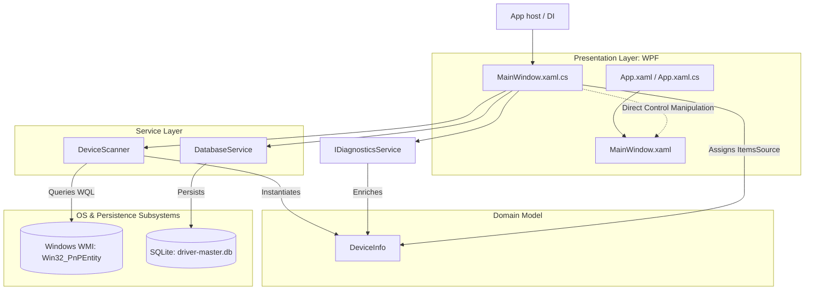
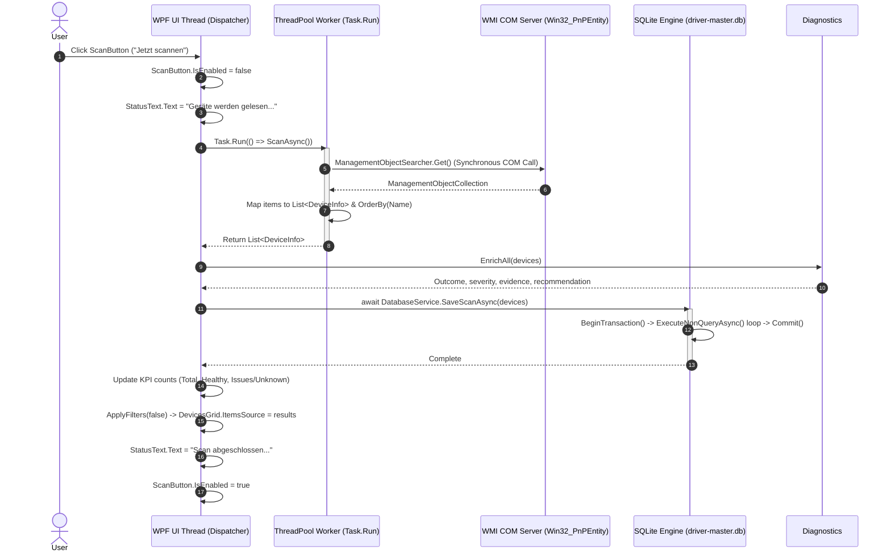

# ARCHITECTURE ANALYSIS
**DriverMasterPro v0.2 Foundation**  
*Senior Reverse Engineering & Architectural Audit*

---

## 1. Architectural Paradigm: Code-Behind Monolith

DriverMasterPro uses a WPF code-behind UI with dependency-injected scanner, database, and diagnostic services. It is not a full MVVM implementation.



### Verified Facts vs. Assumptions
- **Verified Fact**: [MainWindow.xaml.cs](file:///D:/Office/Programs/DriverMasterPro_v0.1_Source/DriverMasterPro_v0.1/MainWindow.xaml.cs#L11-L158) contains event handlers, direct control mutations (`DeviceCount.Text = ...`), LINQ filtering routines, database initialization, and hardcoded translation strings.
- **Verified Fact**: There is no MVVM toolkit, but the application host registers the window and service abstractions for dependency injection.
- **Architectural Consequence**: The window still owns UI event handling and filtering. Rule and persistence behavior have service-level tests; a WPF integration test exercises the scan-to-diagnostics display with fakes.

---

## 2. Component Hierarchy & Layering

### 2.1 Application Entry & Lifecycle
- **App.xaml / App.xaml.cs**:
  - The `OnStartup` hook builds and starts the generic host, registers the scanner, database and diagnostic services, resolves `MainWindow`, and displays it.
  - The application logs unhandled dispatcher exceptions and stops/disposes the host on exit.

### 2.2 Window Controller (`MainWindow`)
- **[MainWindow.xaml](file:///D:/Office/Programs/DriverMasterPro_v0.1_Source/DriverMasterPro_v0.1/MainWindow.xaml#L1-L97)** / **[MainWindow.xaml.cs](file:///D:/Office/Programs/DriverMasterPro_v0.1_Source/DriverMasterPro_v0.1/MainWindow.xaml.cs#L11-L158)**:
  - Hosts the entire user interface in a single window (1160x740 px).
  - Receives `IDeviceScanner`, `IDatabaseService`, and `IDiagnosticsService` through its constructor.
  - Initializes the database on `Loaded`; a scan calls the scanner, enriches results with diagnostics, saves the observations, and displays the inventory and selected-device evidence.
  - Cancels the active scan when closing and enforces a 45-second caller timeout. Cooperative cancellation cannot interrupt a native WMI COM call while that call is blocked.

### 2.3 Domain Model (`DeviceInfo`)
- **[Models/DeviceInfo.cs](file:///D:/Office/Programs/DriverMasterPro_v0.1_Source/DriverMasterPro_v0.1/Models/DeviceInfo.cs#L3-L11)**:
  - A mutable DTO representing an enumerated hardware device.
  - Properties:
    - `Name` (`string`): Device name or fallback `"Unknown device"`.
    - `DeviceId` (`string`): WMI `PNPDeviceID`.
    - `Manufacturer` (`string`): Hardware vendor.
    - `Status` (`string`): WMI device status.
    - `ProblemCode` (`uint?`): Nullable `ConfigManagerErrorCode`; an unavailable value remains unknown instead of becoming zero.
    - `Diagnostics`: Outcome, severity, issue description, raw code evidence, and a non-destructive suggested next step.

### 2.4 Service Layer
- `DeviceScanner` implements `IDeviceScanner` and delegates inventory retrieval to `IDeviceInventoryProvider`; WMI access is read-only.
- `DatabaseService` implements `IDatabaseService`, stores scans transactionally, and exposes cached/active/historical query methods.
- `RuleBasedDiagnosticsService` implements `IDiagnosticsService`. Missing codes, unmapped codes, and conflicting code-zero/status evidence are Unknown. Warning and Critical are local triage levels, not Windows-provided severities.

---

## 3. Concurrency & Threading Model



### Threading Mechanics Analysis
1. **Dispatcher Offloading**:
   - `DeviceScanner.ScanAsync()` wraps its synchronous WMI COM calls in `Task.Run()`, keeping the WPF UI responsive during hardware queries.
2. **UI Marshal Back**:
   - Because `ScanButton_Click` is an `async void` event handler, execution resumes on the WPF UI synchronization context after `await _scanner.ScanAsync()` and `await _database.SaveScanAsync()`. This allows direct assignment to UI controls without calling `Dispatcher.Invoke()`.
3. **Risks in Concurrency**:
   - `_allDevices` is a standard `List<DeviceInfo>` with no synchronization locks. While modifications currently happen on the UI thread, concurrent access from rapid search events during scans could present race conditions.
   - Cancellation is cooperative. A native WMI COM call that blocks cannot be interrupted by the managed cancellation token.

---

## 4. Coupling, Dependencies & Testability Assessment

### Dependency Map

```
DriverMasterPro.csproj
 ├── Microsoft.Data.Sqlite (10.0.0)
 ├── SQLitePCLRaw.bundle_e_sqlite3 (2.1.14)
 └── System.Management (10.0.0)
```

### Coupling Evaluation
1. **Service Coupling**:
   - Production startup resolves `MainWindow` and service abstractions through the host; parameterless window construction remains available for designer/legacy use.
2. **Testability**:
   - The xUnit project tests scanner rules with fakes, database persistence with temporary files, diagnostic outcomes, DI registrations, and scan-to-UI diagnostics on an STA thread.

---

## 5. Internationalization & Bidirectional Layout Architecture

The application implements procedural UI translations:
- **UI Options**: German (default), Arabic, English, French, and Spanish. The diagnostic catalog currently has German and Arabic text; other language selections use German diagnostic text.
- **Trigger**: [LanguageBox_SelectionChanged](file:///D:/Office/Programs/DriverMasterPro_v0.1_Source/DriverMasterPro_v0.1/MainWindow.xaml.cs#L116-L157) in `MainWindow.xaml.cs`.
- **RTL Support**: Dynamically sets `Window.FlowDirection`:
  ```csharp
  FlowDirection = _isArabic ? FlowDirection.RightToLeft : FlowDirection.LeftToRight;
  ```
- **Text Replacement**: Procedurally re-assigns UI labels, filter options, and the seven device-grid column headers. Diagnostic catalog text currently has German and Arabic variants; other UI language selections use the German diagnostic catalog.
- **Architectural Weakness**: Hardcoding translation strings inside C# code-behind prevents standard localization practices (e.g. `.resx` satellite assemblies or XAML `ResourceDictionary` resource swapping).

---

## 6. Security, Privilege & Safety Boundary

- **Privilege Level**: Standard User (`asInvoker`). Administrative elevation (UAC) is neither requested nor required.
- **Safety Boundary**: The application is strictly **read-only**:
  - No driver files (`.sys`, `.inf`, `.cat`) are installed, modified, or removed.
  - No registry keys under `HKLM\SYSTEM\CurrentControlSet\Enum` or `Services` are manipulated.
  - Operations are limited to WMI hardware queries and local database writes in `%LOCALAPPDATA%`.
- **SQL Injection**: Parameterized SQL commands (`$id`, `$name`, etc.) are used consistently, eliminating SQL injection vulnerabilities.
