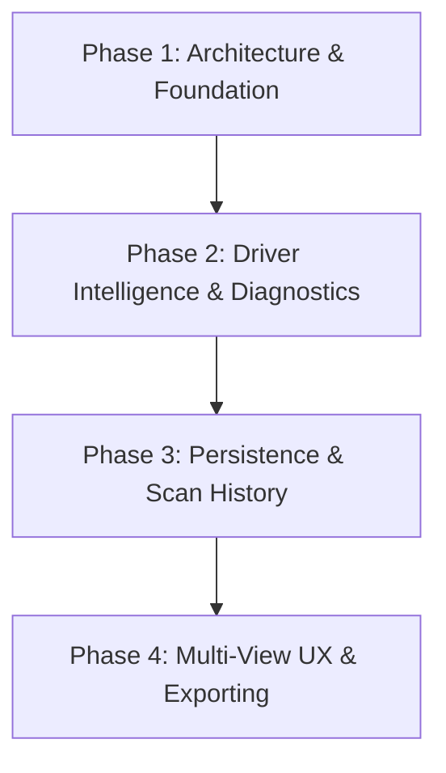

# BUGS, SECURITY & TECHNICAL ROADMAP
**DriverMasterPro v0.2 Foundation**  
*Senior Reverse Engineering & Architectural Audit*

---

## 1. Discovered Bugs, Edge Cases & Deficiencies

### Device identity uncertainty: Resolved without fabricated identity
The WMI provider uses `PNPDeviceID` only. If it is unavailable, the database stores a scan-scoped observation rather than deriving identity from name, manufacturer, or a hash. Such observations cannot be correlated as the same physical device across scans.

---

### WMI cancellation: Bounded with a native-call limitation
The WMI provider sets an enumeration packet timeout and the UI passes a cancellation token with a 45-second caller timeout. Managed cancellation cannot preempt a native COM call while it is blocked; this limitation remains.

---

### SQLite command lifecycle: Resolved
`DatabaseService.SaveScanAsync` reuses and asynchronously disposes its parameterized command inside a transaction. Cancellation or failures are logged and rethrown, and the transaction is not committed on failure.

---

### Bug 4: Version String Inconsistency — FIXED in `3a4a62e`
- **References**:
  - `README.md:1`: `"DRIVER MASTER PRO — v0.2 Foundation"`
  - `artifacts/DriverMasterPro-v0.1.0-win-x64/README.txt:1`: `"DRIVER MASTER PRO v0.1.0"`
  - `MainWindow.xaml:214` (previously cited via a dead `D:/Office/...v0.1` path): text was `"Version 0.2 — Read-only MVP"`, now empty and filled from `Services.AppInfo`. The runtime source was `MainWindow.xaml.cs:776`, not the XAML — see the analysis below.
  - `DriverMasterPro.csproj`: Omits `<Version>` property, defaulting to `1.0.0.0`.
- **Analysis (corrected during the fix)**: Inconsistent version numbers across documentation, release packages, and user interface confuse users and release automation. The XAML literal was not merely a design-time default: `LanguageBox_SelectionChanged` begins with `if (!IsLoaded) return;`, so the language pass never ran at startup and the hardcoded XAML text is what users actually saw. `artifacts/*/README.txt` still says `v0.1.0`, but `artifacts/` is gitignored and untracked, so it is local build output and never ships.
- **Fix applied**: `<Version>0.2.0</Version>` is declared once in `DriverMasterPro.csproj`. `Services/AppInfo.cs` reads the number back from assembly metadata (`Assembly.GetName().Version`, deliberately not `InformationalVersion`, which carries a SourceLink `+sha`). The five localized labels live in one `VersionLabelTemplates` array in `MainWindow.xaml.cs` with a `{version}` placeholder; the constructor seeds the default German label from it and the language pass formats the same array. A single `VersionLabel` string cannot work, because the localized templates differ in prefix (`Versión`, `الإصدار`).

---

### Bug 5: Incomplete RTL Layout Mirroring — margins FIXED in `3a4a62e`; startup RTL closed by Bug 6
- **File Reference**: `MainWindow.xaml:335` (`HistoryLabel`), `:371` (`SearchLabel`), `:381` (`FilterLabel`). The previously cited `D:/Office/...v0.1` lines 49/55/61 are stale; the original entry also missed `FilterLabel`.
- **Code before the fix** (the v0.1 `<Border>` snippet that used to sit here did not match this codebase and has been removed):
  ```xml
  <TextBlock x:Name="HistoryLabel" ... Margin="0,0,10,0"/>
  <TextBlock x:Name="SearchLabel"  ... Margin="0,0,10,0"/>
  <TextBlock x:Name="FilterLabel"  ... Margin="17,0,10,0"/>
  ```
- **Analysis**: WPF `FlowDirection.RightToLeft` mirrors general layout, but explicit asymmetric margins (`Margin="10,0,0,0"`) do not automatically flip their left/right offsets.
- **Impact**: In Arabic RTL mode, card spacing becomes visually asymmetrical.
- **Fix applied**: `HistoryLabel` and `SearchLabel` were `Margin="0,0,10,0"` and `FilterLabel` was `Margin="17,0,10,0"`. All three are now symmetric `Margin="10,0"`, so the gap renders identically in both flow directions. Note `FilterLabel` moves 7 px left as a result — accepted, to keep one spacing token across the three labels.

---

### Bug 6: RTL at startup and language persistence — FIXED in `33d42f8`
- **File Reference**: `MainWindow.xaml.cs` (4-param ctor, `ApplyLanguage`), `Services/JsonSettingsService.cs`, `App.xaml.cs:23`.
- **Analysis (as found)**: Symmetric margins (Bug 5) are a prerequisite, not a solution. `FlowDirection` was wired but dead at startup: the app always rendered LTR until the user manually switched language, and the choice was not persisted, so a restart returned to LTR.
- **Fix applied**: `ISettingsService` + `AppSettings` (schema 1) + `JsonSettingsService` persist the language index to `%LOCALAPPDATA%\DriverMasterPro\settings.json` using a temp file + `File.Move`, so an interrupted write cannot silently reset the user's language. Missing, corrupt and unreadable files fall back to German. `MainWindow` applies the saved language **before the first frame**, and `ApplyLanguage` persists only real changes via `_lastPersistedIndex`. `ISettingsService` is registered in DI so `MainWindow` resolves through exactly one constructor.
- **Coverage**: 7 tests, including `ArabicStartup_AppliesRightToLeftOnFirstFrame` (asserts `FlowDirection.RightToLeft` before `Show()` completes) and `SwitchingLanguage_PersistsSelection`.

---

### Bug 7 (open): settings-file pollution is closed per call-site, not by construction
- **Analysis**: `MainWindow` now reads a settings file by default, so any test that calls `new MainWindow(scanner, database, diagnostics)` without injecting `ISettingsService` reads the developer's real `%LOCALAPPDATA%` file. This was observed: one test switching language wrote `LanguageIndex: 4`, and later German-asserting tests failed by reading Spanish.
- **Current mitigation**: all 4 test call sites inject `InMemorySettingsService`. This is enforcement by discipline, not by the type system.
- **Remaining work**: remove or internalise the parameterless `MainWindow()` constructor (currently kept for the WPF designer — it is the only place a window is built without injection), or fail fast in tests when a real settings path is used.
- **Status**: Open, accepted for v0.2.

---

### Note: why `App.xaml.cs` registers `ISettingsService`
`MainWindow` gained a fourth constructor dependency, and the parameterless overload still exists for the designer. Measured on this target framework with a two-constructor probe: `ServiceProvider` **applies default parameter values** when selecting a constructor, so with `ISettingsService` unregistered the 4-parameter overload is still chosen and `settings` is `null`. The registration therefore does **not** prevent a fallback to the parameterless constructor — it ensures the registered instance is injected instead of `null`. Because the constructor coalesces null (`settings ?? new JsonSettingsService()`), the failure mode without the registration is a second, container-bypassing settings instance, not an exception.
- **Guard:** `MainWindow_ReceivesTheRegisteredSettingsInstance` registers a spy and asserts its `Load` was called, which proves injection into the consumer rather than mere singleton identity. `SettingsService_IsRegisteredInTheApplicationHost` asserts the registration exists in `App.CreateHostBuilder()`.
- **History:** an earlier revision of this note claimed the registration prevented a silent fallback to the parameterless constructor. That was wrong and has been corrected here.

---

## 2. Security & Operational Assessment

### 2.1 Privilege Profile
- **Status**: **Secure & Compliant**.
- Operates under standard user rights without requiring administrative elevation (UAC prompt).
- Does not modify protected system directories (`%ProgramFiles%`, `%SystemRoot%`, Windows Driver Store).

### 2.2 SQL Injection Assessment
- **Status**: **Safe**.
- All queries in `Services/DatabaseService.cs` use parameterized statements (`$id`, `$name`, etc.). No dynamic string interpolation is present in SQL statements. (The former `D:/Office/...v0.1` link was a local untracked path and has been removed.)

### 2.3 WMI Subsystem Impact
- Enumerating `Win32_PnPEntity` generates brief CPU spikes in `WmiPrvSE.exe` (WMI Provider Host). This is normal behavior for full Plug-and-Play WMI queries on Windows.

---

## 3. Prioritized Modernization Roadmap



---

### Phase 1: Architecture & Foundation (Priority: High)
1. **Refactor to MVVM**:
   - Introduce `CommunityToolkit.Mvvm`.
   - Create `MainViewModel` and extract business logic and filtering from `MainWindow.xaml.cs`.
2. **Implement Dependency Injection**:
   - Set up `Microsoft.Extensions.Hosting` (`IHost`, `IServiceCollection`).
   - Register services: `IDeviceScanner`, `IDatabaseService`, `ILocalizationService`.
3. **Declarative Localization**:
   - Replace procedural string rewriting with XAML `ResourceDictionary` bundles (`Strings.de.xaml`, `Strings.ar.xaml`, `Strings.en.xaml`).
   - Add **English (`en`)** as an available language.
4. **Unit Test Suite — DONE**:
   - `DriverMasterPro.Tests` exists on xUnit 2.9.3 with hand-written fakes. `Moq` was not adopted: fake services are already used throughout the suite and are cheaper than a mocking framework here. Currently 67/67 green (59 unit + 8 live-WMI).

---

### Phase 2: Driver Intelligence & Diagnostics (Priority: High)
1. **Extract Detailed Driver Metadata**:
   - Query `Win32_PnPSignedDriver` or integrate Windows SetupAPI via P/Invoke.
   - Extract: Driver Version, Driver Date, Driver Provider, INF Name, and WHQL Digital Signature status.
2. **Actionable Problem Code Resolution**:
   - **Implemented:** A diagnostic catalog maps known `ConfigManagerErrorCode` values to local outcomes, evidence, and non-destructive recommendations. Missing, unmapped, or conflicting evidence remains Unknown; the catalog does not establish root cause. Further validation of the catalog against Windows documentation remains appropriate:
     - Codes 10, 28, and 43 have catalog entries; suggested next steps are non-destructive and do not claim a root cause.
3. **Device Categorization**:
   - Group devices into categories (Display, Audio, Network, Storage, USB, System).

---

### Phase 3: Persistence, History & Offline Cache (Priority: Medium)
1. **Startup Cache Loading — DONE**:
   - The most recent scan is loaded and displayed at startup via `MainWindow.LoadPersistedInventoryAsync`; covered by `CacheHistoryUiTests` (stale/empty-history/duplicate-observation cases).
2. **Scan History & Diff Inspection**:
   - Provide a dedicated UI page to browse past scans.
   - Highlight hardware and driver changes between scans (devices connected, disconnected, updated).
3. **Application Settings Persistence**:
   - Store user preferences (selected language, window size/position) in an `AppSettings` SQLite table or JSON config.

---

### Phase 4: Multi-View UX & Exporting (Priority: Medium)
1. **Multi-Page Shell Navigation**:
   - Implement navigation between `DashboardView`, `InventoryView`, `HistoryView`, and `SettingsView`.
2. **Export Engine**:
   - Export scan reports to CSV, JSON, and formatted HTML summaries.
3. **Search & Filter Enhancements**:
   - Add category filter chips and sortable column headers.
