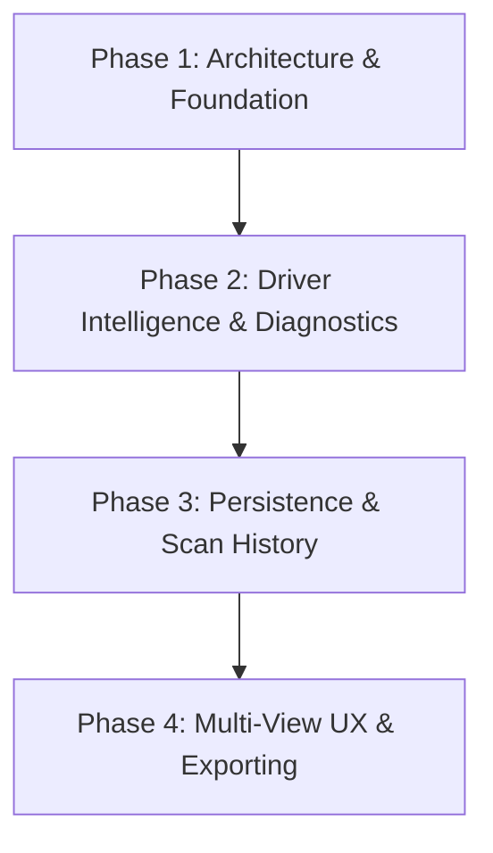

# BUGS, SECURITY & TECHNICAL ROADMAP
**DriverMasterPro v0.2 Foundation**  
*Senior Reverse Engineering & Architectural Audit*

---

## 1. Discovered Bugs, Edge Cases & Deficiencies

### Device identity uncertainty: Resolved without fabricated identity
The WMI provider uses `PNPDeviceID` only. If it is unavailable, the database stores a scan-scoped observation rather than deriving identity from name, manufacturer, or a hash. Such observations cannot be correlated as the same physical device across scans.

---

### WMI cancellation: Bounded with a native-call limitation
The WMI provider sets an enumeration packet timeout and the UI passes a cancellation token with a 45-second caller timeout. Managed cancellation cannot preempt a native COM call while it is blocked; this limitation remains.

---

### SQLite command lifecycle: Resolved
`DatabaseService.SaveScanAsync` reuses and asynchronously disposes its parameterized command inside a transaction. Cancellation or failures are logged and rethrown, and the transaction is not committed on failure.

---

### Bug 4: Version String Inconsistency
- **References**:
  - `README.md:1`: `"DRIVER MASTER PRO — v0.2 Foundation"`
  - `artifacts/DriverMasterPro-v0.1.0-win-x64/README.txt:1`: `"DRIVER MASTER PRO v0.1.0"`
  - [MainWindow.xaml:26](file:///D:/Office/Programs/DriverMasterPro_v0.1_Source/DriverMasterPro_v0.1/MainWindow.xaml#L26): `"Version 0.2 — Read-only MVP"`
  - `DriverMasterPro.csproj`: Omits `<Version>` property, defaulting to `1.0.0.0`.
- **Analysis**: Inconsistent version numbers across documentation, release packages, and user interface confuse users and release automation.
- **Recommended Fix**: Centralize `<Version>0.1.0</Version>` in `DriverMasterPro.csproj` and bind UI labels to `Assembly.GetExecutingAssembly().GetName().Version`.

---

### Bug 5: Incomplete RTL Layout Mirroring
- **File Reference**: [MainWindow.xaml:49, 55, 61](file:///D:/Office/Programs/DriverMasterPro_v0.1_Source/DriverMasterPro_v0.1/MainWindow.xaml#L49)
- **Code**:
  ```xml
  <Border Margin="0,0,10,0" ... />
  <Border Margin="5,0" ... />
  <Border Margin="10,0,0,0" ... />
  ```
- **Analysis**: WPF `FlowDirection.RightToLeft` mirrors general layout, but explicit asymmetric margins (`Margin="10,0,0,0"`) do not automatically flip their left/right offsets.
- **Impact**: In Arabic RTL mode, card spacing becomes visually asymmetrical.
- **Recommended Fix**: Use uniform column spacing via `Grid` column definitions or symmetrical margins (`Margin="5,0"`).

---

## 2. Security & Operational Assessment

### 2.1 Privilege Profile
- **Status**: **Secure & Compliant**.
- Operates under standard user rights without requiring administrative elevation (UAC prompt).
- Does not modify protected system directories (`%ProgramFiles%`, `%SystemRoot%`, Windows Driver Store).

### 2.2 SQL Injection Assessment
- **Status**: **Safe**.
- All queries in [DatabaseService.cs](file:///D:/Office/Programs/DriverMasterPro_v0.1_Source/DriverMasterPro_v0.1/Services/DatabaseService.cs) use parameterized statements (`$id`, `$name`, etc.). No dynamic string interpolation is present in SQL statements.

### 2.3 WMI Subsystem Impact
- Enumerating `Win32_PnPEntity` generates brief CPU spikes in `WmiPrvSE.exe` (WMI Provider Host). This is normal behavior for full Plug-and-Play WMI queries on Windows.

---

## 3. Prioritized Modernization Roadmap



---

### Phase 1: Architecture & Foundation (Priority: High)
1. **Refactor to MVVM**:
   - Introduce `CommunityToolkit.Mvvm`.
   - Create `MainViewModel` and extract business logic and filtering from `MainWindow.xaml.cs`.
2. **Implement Dependency Injection**:
   - Set up `Microsoft.Extensions.Hosting` (`IHost`, `IServiceCollection`).
   - Register services: `IDeviceScanner`, `IDatabaseService`, `ILocalizationService`.
3. **Declarative Localization**:
   - Replace procedural string rewriting with XAML `ResourceDictionary` bundles (`Strings.de.xaml`, `Strings.ar.xaml`, `Strings.en.xaml`).
   - Add **English (`en`)** as an available language.
4. **Unit Test Suite**:
   - Create `DriverMasterPro.Tests` project using `xUnit` and `Moq`.

---

### Phase 2: Driver Intelligence & Diagnostics (Priority: High)
1. **Extract Detailed Driver Metadata**:
   - Query `Win32_PnPSignedDriver` or integrate Windows SetupAPI via P/Invoke.
   - Extract: Driver Version, Driver Date, Driver Provider, INF Name, and WHQL Digital Signature status.
2. **Actionable Problem Code Resolution**:
   - **Implemented:** A diagnostic catalog maps known `ConfigManagerErrorCode` values to local outcomes, evidence, and non-destructive recommendations. Missing, unmapped, or conflicting evidence remains Unknown; the catalog does not establish root cause. Further validation of the catalog against Windows documentation remains appropriate:
     - Codes 10, 28, and 43 have catalog entries; suggested next steps are non-destructive and do not claim a root cause.
3. **Device Categorization**:
   - Group devices into categories (Display, Audio, Network, Storage, USB, System).

---

### Phase 3: Persistence, History & Offline Cache (Priority: Medium)
1. **Startup Cache Loading**:
   - Load and display the most recent scan from SQLite immediately upon application startup.
2. **Scan History & Diff Inspection**:
   - Provide a dedicated UI page to browse past scans.
   - Highlight hardware and driver changes between scans (devices connected, disconnected, updated).
3. **Application Settings Persistence**:
   - Store user preferences (selected language, window size/position) in an `AppSettings` SQLite table or JSON config.

---

### Phase 4: Multi-View UX & Exporting (Priority: Medium)
1. **Multi-Page Shell Navigation**:
   - Implement navigation between `DashboardView`, `InventoryView`, `HistoryView`, and `SettingsView`.
2. **Export Engine**:
   - Export scan reports to CSV, JSON, and formatted HTML summaries.
3. **Search & Filter Enhancements**:
   - Add category filter chips and sortable column headers.
