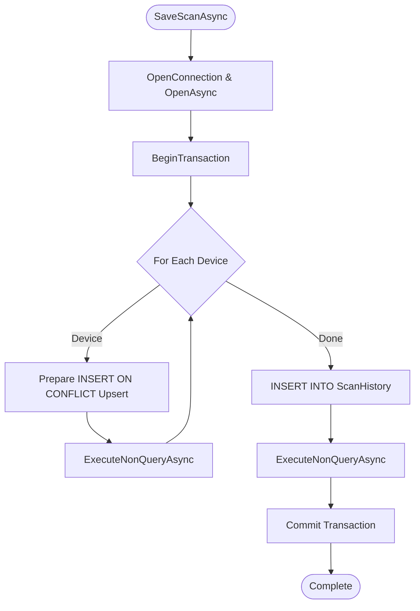

# DATABASE ANALYSIS
**DriverMasterPro v0.2 Foundation**  
*Senior Reverse Engineering & Architectural Audit*

---

## 1. Storage Configuration & Database Engine

Local storage is managed by [DatabaseService.cs](file:///D:/Office/Programs/DriverMasterPro_v0.1_Source/DriverMasterPro_v0.1/Services/DatabaseService.cs).

### Engine & Connection Details
- **Database Engine**: SQLite 3 (via `Microsoft.Data.Sqlite` 10.0.0 and `SQLitePCLRaw.bundle_e_sqlite3` 2.1.14).
- **Physical File Path**:
  ```csharp
  Path.Combine(Environment.GetFolderPath(Environment.SpecialFolder.LocalApplicationData), "DriverMasterPro", "driver-master.db")
  ```
  Resolves on Windows to: `%LOCALAPPDATA%\DriverMasterPro\driver-master.db`.
- **Directory Creation**: [DatabaseService.cs:15](file:///D:/Office/Programs/DriverMasterPro_v0.1_Source/DriverMasterPro_v0.1/Services/DatabaseService.cs#L15) calls `Directory.CreateDirectory(folder)` during service instantiation.
- **Connection String**: `Data Source={_dbPath}`.

---

## 2. Database Schema DDL Analysis

The schema is initialized in [DatabaseService.cs:26-40](file:///D:/Office/Programs/DriverMasterPro_v0.1_Source/DriverMasterPro_v0.1/Services/DatabaseService.cs#L26-L40):

```sql
CREATE TABLE IF NOT EXISTS Devices (
    DeviceId TEXT PRIMARY KEY,
    Name TEXT NOT NULL,
    Manufacturer TEXT,
    Status TEXT,
    ProblemCode INTEGER,
    ProblemCodeEvidenceAvailable INTEGER NOT NULL DEFAULT 1,
    LastSeenUtc TEXT NOT NULL
);

CREATE TABLE IF NOT EXISTS ScanHistory (
    Id INTEGER PRIMARY KEY AUTOINCREMENT,
    ScanTimeUtc TEXT NOT NULL,
    DeviceCount INTEGER NOT NULL
);
```

### Table Breakdown

#### Table 1: `Devices`
| Column Name | SQL Type | Nullable | Key / Constraint | Description |
| :--- | :--- | :---: | :---: | :--- |
| `DeviceId` | `TEXT` | No | `PRIMARY KEY` | Windows Plug-and-Play Device ID (`PNPDeviceID`). |
| `Name` | `TEXT` | No | None | Friendly device display name. |
| `Manufacturer` | `TEXT` | Yes | None | Hardware manufacturer / vendor name. |
| `Status` | `TEXT` | Yes | None | Operational status string (e.g. `"OK"`). |
| `ProblemCode` | `INTEGER` | Yes | None | Raw Configuration Manager error code. |
| `ProblemCodeEvidenceAvailable` | `INTEGER` | No | `1` | Whether the stored problem code came from an available WMI value. |
| `LastSeenUtc` | `TEXT` | No | None | ISO 8601 UTC timestamp of the most recent scan (`"O"` format). |

#### Table 2: `ScanHistory`
| Column Name | SQL Type | Nullable | Key / Constraint | Description |
| :--- | :--- | :---: | :---: | :--- |
| `Id` | `INTEGER` | No | `PRIMARY KEY AUTOINCREMENT` | Monotonically increasing record ID. |
| `ScanTimeUtc` | `TEXT` | No | None | ISO 8601 UTC timestamp of scan execution. |
| `DeviceCount` | `INTEGER` | No | None | Total count of enumerated devices during this scan. |

---

## 3. Data Ingestion & Transaction Logic

Device scans are saved inside [DatabaseService.SaveScanAsync()](file:///D:/Office/Programs/DriverMasterPro_v0.1_Source/DriverMasterPro_v0.1/Services/DatabaseService.cs#L44-L76):



### Upsert Logic (`INSERT ... ON CONFLICT`)
To prevent duplicate key exceptions on subsequent scans, the query uses SQLite's native upsert:
```sql
INSERT INTO Devices(
    DeviceId, Name, Manufacturer, Status, ProblemCode,
    ProblemCodeEvidenceAvailable, LastSeenUtc)
VALUES($id, $name, $manufacturer, $status, $problem, $problemEvidence, $seen)
ON CONFLICT(DeviceId) DO UPDATE SET
    Name=excluded.Name,
    Manufacturer=excluded.Manufacturer,
    Status=excluded.Status,
    ProblemCode=excluded.ProblemCode,
    ProblemCodeEvidenceAvailable=excluded.ProblemCodeEvidenceAvailable,
    LastSeenUtc=excluded.LastSeenUtc;
```

### Device Identity and Unidentified Observations
The WMI provider uses a non-empty `PNPDeviceID` as the supplied database key, but does not independently verify that it proves the same physical device across scans. If the field is missing, it leaves `DeviceId` empty; `DatabaseService` assigns a unique scan-scoped observation ID. It does not substitute a name, manufacturer, hash, or WMI `DeviceID` as proof of physical identity. Unidentified observations cannot be reliably correlated across scans. Repeated IDs within one scan are retained as separate observations rather than overwriting one another.

`ProblemCode` remains nullable. A missing `ConfigManagerErrorCode` is stored as SQL `NULL` and must not be interpreted as code zero or a healthy device. On upgrade, legacy rows whose stored code is zero are conservatively marked as lacking code evidence; their original stored value is retained, but reads expose the code as unknown. New rows distinguish an observed code zero from unavailable evidence.

---

## 4. UI Persistence Integration Gaps

### Verified Fact
- `DatabaseService` initializes the schema, transactionally saves scan observations and history, and provides cached, active-scan, and historical-device queries.
- The current desktop UI invokes initialization and saves scans. It does not expose a scan-history browser or load cached inventory on startup.

### Impact & Unfinished State
1. **Disconnected History UI**: `ScanHistory` records accumulate without a user-facing history browser.
2. **No Startup Cache Display**: On launch, the inventory remains empty until a new scan, even though persisted records can be queried by the service.
3. **No automatic current-device reconciliation**: historical records remain in the table; a device absent from a later scan is not deleted or automatically marked removed.

---

## 5. Resource Management & Command Allocation

In the current [DatabaseService.SaveScanAsync()](file:///D:/Office/Programs/DriverMasterPro_v0.1_Source/DriverMasterPro_v0.1/Services/DatabaseService.cs):
```csharp
await using var command = connection.CreateCommand();
command.Transaction = transaction;
command.CommandText = "...";
// Parameters are bound once and updated for each device.
foreach (var device in devices)
{
    await command.ExecuteNonQueryAsync();
}
```
- **Verified behavior**: A single parameterized command is reused for the scan and disposed asynchronously. Scan writes and history insertion share a transaction.

---

## 6. Recommended Future Schema Migration

To support history diffing, offline reload, and driver versioning in v0.2+, the schema should be restructured:

```sql
-- Normalization of Scans
CREATE TABLE IF NOT EXISTS Scans (
    ScanId INTEGER PRIMARY KEY AUTOINCREMENT,
    TimestampUtc TEXT NOT NULL,
    TotalDevices INTEGER NOT NULL,
    ProblemDevices INTEGER NOT NULL,
    ScanDurationMs INTEGER
);

-- Normalized Device Catalog
CREATE TABLE IF NOT EXISTS Devices (
    DeviceId TEXT PRIMARY KEY,
    Name TEXT NOT NULL,
    Manufacturer TEXT,
    HardwareClass TEXT
);

-- Historical Scan Snapshots
CREATE TABLE IF NOT EXISTS ScanSnapshots (
    ScanId INTEGER NOT NULL REFERENCES Scans(ScanId) ON DELETE CASCADE,
    DeviceId TEXT NOT NULL REFERENCES Devices(DeviceId),
    Status TEXT,
    ProblemCode INTEGER NOT NULL,
    DriverVersion TEXT,
    DriverDate TEXT,
    PRIMARY KEY (ScanId, DeviceId)
);

CREATE INDEX IF NOT EXISTS IX_ScanSnapshots_DeviceId ON ScanSnapshots(DeviceId);
CREATE INDEX IF NOT EXISTS IX_Scans_TimestampUtc ON Scans(TimestampUtc DESC);
```
